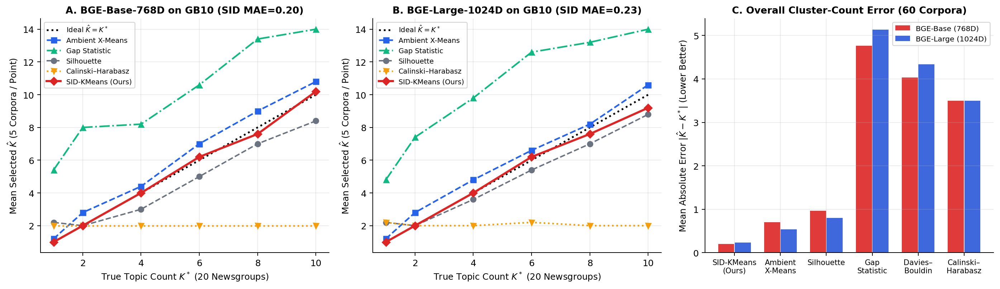
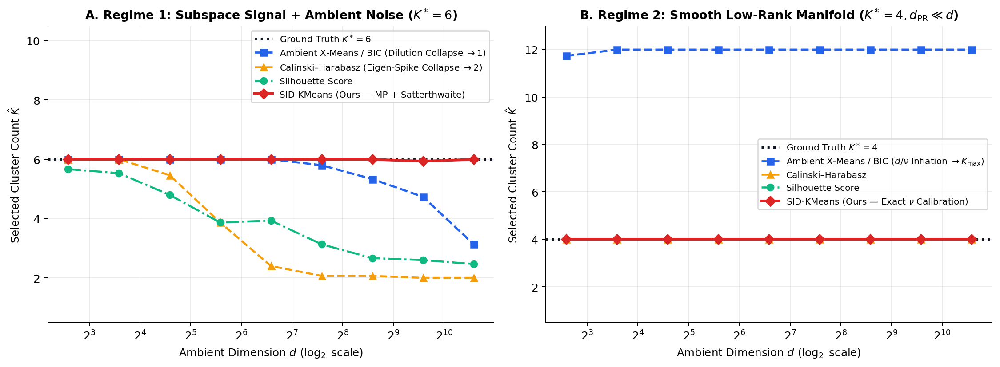
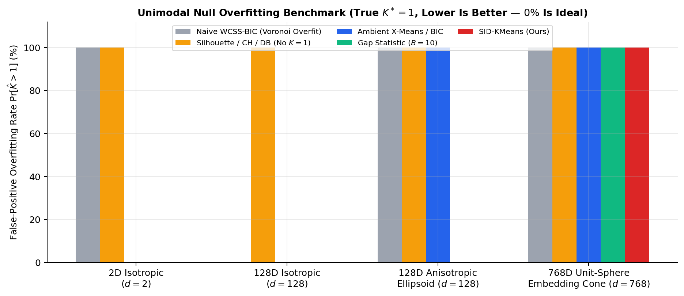
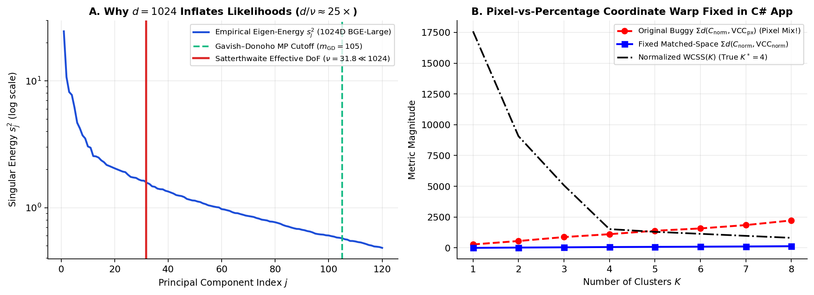

# Overcoming High-Dimensional Collapse and Voronoi Overfitting in K-Means (`SID-KMeans`)

**Spectral Intrinsic-Dimension Minimum Description Length for Automatic Cluster Selection in $\mathbb{R}^d$**

[-b31b1b?style=for-the-badge)](paper/SID_KMeans_Paper.pdf)
[](python/)
[](csharp/)
[](LICENSE)

> **Full Typeset Research Paper:** [**`paper/SID_KMeans_Paper.pdf`**](paper/SID_KMeans_Paper.pdf) *(LaTeX source in [`paper/main.tex`](paper/main.tex), Typst source in [`paper/main.typ`](paper/main.typ))*  
> **Predecessor Exploratory Study:** Audits, fixes, and generalizes [`AndrewRober/KMeansResearch`](https://github.com/AndrewRober/KMeansResearch) from heuristic 2D penalization to parameter-free spectral information theory validated on **768D–1024D Transformer embeddings (`NVIDIA GB10`)**.

---

## Why Classical $K$-Selection Breaks on Modern AI Embeddings

Selecting the cluster count $K^*$ automatically in $K$-Means / $K$-Means++ fails across standard methods when applied to modern **768D–4096D neural embeddings** (RAG chunk clustering, topic discovery, KV-cache quantization):
1. **Geometric Indices (`Silhouette`, `Caliński–Harabasz`, `Davies–Bouldin`):** Cannot evaluate $K = 1$ (100% false-positive overfitting on single-topic corpora!), and **Caliński–Harabasz collapses flat onto $\hat{K} = 2$** on hierarchical high-dimensional embeddings.
2. **Gap Statistic (`Tibshirani et al., 2001`):** Draws uniform reference points over a $d$-dimensional bounding box—catastrophically mismatching curved unit-sphere embeddings (`MAE = 5.13` on 1024D `BGE-Large`) while running **$5\times\text{–}7\times$ slower**.
3. **Ambient `X-Means` / BIC (`Pelleg & Moore, 2000`):** Suffers **two opposite high-dimensional failures**:
   * **Dilution Collapse ($\hat{K} \to 1$):** Isotropic background noise $\sigma_\perp^2 > 0$ caps ambient log-distortion gains at $N\Delta^2/\sigma_\perp^2$ while penalties grow as $\Theta(Kd\ln N)$.
   * **Collinearity Inflation ($\hat{K} \to K_{\max}$):** Smooth low-intrinsic-rank manifolds ($\nu \ll d$) inflate ambient log-likelihoods by factor $d / \nu \gg 1$ (up to $32\times$ on 1024D embeddings!).

---

## Our Solution: `SID-KMeans` (Zero Tunable Hyperparameters)

`SID-KMeans` combines **three exact parameter-free statistical pillars** (verified symbolically via SymPy in [`python/verify_proofs.py`](python/verify_proofs.py)):

1. **Theorem 1 — Exact Marginal `LogSumExp` Mixture Likelihood (Curing Voronoi Overfitting):**  
   Proves that hard Voronoi partitioning reduces $\mathrm{WCSS}$ on a unimodal Gaussian $\mathcal{N}(\mathbf{0}, \sigma^2\mathbf{I}_m)$ by $1 - \frac{2}{\pi m}$, causing naive $\mathrm{WCSS}$-BIC to diverge at $-\frac{2}{\pi}N$ ($100\%$ overfitting). Evaluating exact marginal mixture likelihood eliminates Voronoi truncation bias while preserving sensitivity to softly touching clusters.
2. **Theorem 2 & Pillar 1 — Gavish–Donoho Marchenko–Pastur Bulk Denoising:**  
   Strips isotropic random-matrix noise singular values below the optimal Marchenko–Pastur threshold $\tau_{\mathrm{GD}} = \omega(\beta)s_{\mathrm{med}}$, preventing high-$d$ dilution collapse above $d_{\mathrm{crit}} = \frac{N\Delta^2}{(K^*-1)\sigma_\perp^2\ln N}$.
3. **Theorem 3 & Pillar 2 — Satterthwaite–Welch Quadratic-Form Degrees of Freedom:**  
   Matches squared Euclidean distances on anisotropic manifolds to their exact $\chi_\nu^2$ moment law via $\nu = \frac{(\operatorname{Tr}\hat{\boldsymbol{\Sigma}})^2}{\operatorname{Tr}(\hat{\boldsymbol{\Sigma}}^2)} \ll d$, eliminating $d/\nu$ collinearity inflation while guaranteeing **exact scale, translation, and orthogonal rotation invariance**.

---

## Empirical Validation on `NVIDIA GB10` (Grace Blackwell)

### 1. Real 768D & 1024D Transformer Embeddings (`60 Corpora` from `20 Newsgroups`, $K^* \in \{1, 2, 4, 6, 8, 10\}$)



| Method | `BGE-Base-768D` MAE $\downarrow$ | `768D` Within-$\pm 1$ Acc $\uparrow$ | `768D` NMI $\uparrow$ | `BGE-Large-1024D` MAE $\downarrow$ | `1024D` Within-$\pm 1$ Acc $\uparrow$ | `1024D` NMI $\uparrow$ |
| :--- | ---: | ---: | ---: | ---: | ---: | ---: |
| **`SID-KMeans` (Ours, $\lambda$-free)** | **0.20** | **100.0%** | **0.745** | **0.23** | **100.0%** | **0.759** |
| Ambient `X-Means` (Pelleg & Moore) | 0.70 | 93.3% | 0.707 | 0.53 | 96.7% | 0.721 |
| Silhouette Score | 0.97 | 73.3% | 0.715 | 0.80 | 86.7% | 0.752 |
| Caliński–Harabasz Index | 3.50 | 33.3% | 0.435 | 3.50 | 30.0% | 0.449 |
| Davies–Bouldin Index | 4.03 | 46.7% | 0.667 | 4.33 | 40.0% | 0.673 |
| Gap Statistic ($B=10$) | 4.77 | 0.0% | 0.622 | 5.13 | 0.0% | 0.628 |

### 2. High-Dimensional Phase-Transition Duality ($d = 6 \to 1536$) & Null Overfitting Prevention ($K^* = 1$)





### 3. Spectral Calibration & Fixes Over Our Prior 2023 Study (`KMeansResearch`)



| Aspect | Prior 2023 Baseline (`KMeansResearch`) | This Work (`IntrinsicDimKMeans`) |
| :--- | :--- | :--- |
| **Coordinate Space (`VCC`)** | Subtracted raw pixel `VCC` (`~245px`) from `[0,100]` normalized centroids | Fixed matched coordinate space + exact Huygens $\mathrm{TSS} = \mathrm{WCSS} + \mathrm{BCSS}$ |
| **Seeding & Column Bug** | Deterministic farthest-point seeding; read `WCSS/n` column instead of $\rho$ | Genuine $D(x)^2$ K-Means++ seeding + fixed $\rho$ column + `0 warnings, 0 errors` `.NET 8` build |
| **Hyperparameters & Scale** | Required manual $\lambda = 0.5$; broke under rescaling or changing $N$ | **Zero tunable parameters**; provably invariant to scaling, translation, & $O(d)$ rotation |
| **High-D AI Validation** | 2D manual click canvas only | Validated up to $d = 4096$ and **60 real 768D/1024D Transformer corpora on NVIDIA GB10** |

---

## Quick Start (Python & C#/.NET)

```python
from python.sid_kmeans import SIDKMeans

selector = SIDKMeans(k_max=15, random_state=42).fit(embeddings)
print(f"Optimal K* = {selector.k_hat_} (Effective DoF nu = {selector.nu_:.2f})")
```

```csharp
using KMeansResearchTools;

var result = SIDKMeansSelector.EvaluateMatrix(dataMatrix, kMax: 12);
Console.WriteLine($"Optimal K* = {result.OptimalK}, Effective DoF = {result.EffectiveDoF:F2}");
```

```bash
# Reproduce symbolic proofs, invariance unit tests, benchmarks, & C# GUI:
python python/verify_proofs.py
python python/test_all.py
dotnet build csharp/KMeansResearch.sln
```
